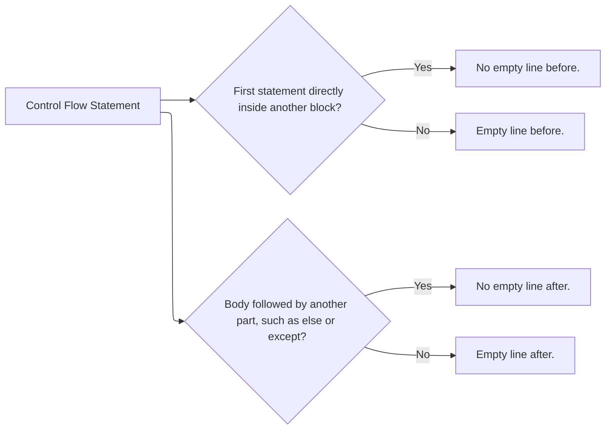

# Code Style & Tooling Guidelines

This document outlines the general style guidelines and the shared tooling and editor configuration for our development, and links to the language-specific style guidelines.

## General Style Guidelines

These guidelines apply to all languages. The language-specific style guidelines are linked in the table under [Editor & Repository Setup](#editor--repository-setup).

### Comments and Logs

- Write comments, log messages, etc. either as full sentences with punctuation, or as Title Case headings without punctuation, such as a comment that labels the code that follows.
- Where a tool has a well-established convention that clashes with ours, follow the tool's convention instead. For example, `argparse` help texts are lowercase without punctuation.

#### Example

```python
parser.add_argument("--output-directory", help="directory to write the package to")

# Validate Inputs
if not pins:
    # Nothing is pinned, so there is no package to build.
    print("Error: No tools are pinned in requirements-dev.txt.", file=sys.stderr)
    sys.exit(1)
```

### Empty Lines Around Control Flow



#### Example

```python
total = 0

for row in rows:
    for cell in row:
        if cell is None:
            continue

        total += cell

if total > limit:
    print("The total exceeds the limit.")
else:
    print("The total is within the limit.")

print(f"Total: {total}")
```

## Tooling & Editor Configuration

We use **[Visual Studio Code](https://code.visualstudio.com/)** as our primary IDE. To ensure everyone's code is formatted identically and automatically upon saving, you must set up the tools and editor as described below.

### Tools

All formatters and linters come in the `sfg-contribution-tooling` package. [Add the SFG APT repository](https://github.com/sfg-autonomous-systems/sfg_apt_repo#add-the-apt-repository), then install the package:

```bash
sudo apt install sfg-contribution-tooling
```

The package installs `clang-format`, `dprint`, `ruff`, `rumdl`, `shellcheck`, `shfmt` and `ty` to `/opt/sfg-contribution-tooling/bin/`, which is not on the `PATH`, the dprint plugins to `/opt/sfg-contribution-tooling/share/dprint/`, and the configuration files from [`config/`](config/) to `/opt/sfg-contribution-tooling/share/config/`.

### Editor & Repository Setup

For each language the repository uses, install the extensions and copy the configuration files from [`config/`](config/) into the repository root:

| Language                  | Extensions                                                                       | Configuration Files                                                              | Language-Specific Style Guidelines |
| ------------------------- | -------------------------------------------------------------------------------- | -------------------------------------------------------------------------------- | ---------------------------------- |
| C/C++                     | [`ms-vscode.cpptools`][cpptools]                                                 | [`.clang-format`](config/.clang-format)                                          | [C/C++](style/c_cpp.md)            |
| CMake                     | [`josetr.cmake-language-support-vscode`][cmake]                                  |                                                                                  | [CMake](style/cmake.md)            |
| Dockerfile/JSON/TOML/YAML | [`dprint.dprint`][dprint]                                                        | [`dprint.jsonc`](config/dprint.jsonc)                                            |                                    |
| Markdown                  | [`rvben.rumdl`][rumdl]                                                           | [`.rumdl.toml`](config/.rumdl.toml)                                              |                                    |
| Python                    | [`ms-python.python`][python], [`charliermarsh.ruff`][ruff], [`astral-sh.ty`][ty] | [`ruff.toml`](config/ruff.toml), [`ty.toml`](config/ty.toml)                     | [Python](style/python.md)          |
| Shell                     | [`mads-hartmann.bash-ide-vscode`][bash-ide]                                      | [`.editorconfig`](config/.editorconfig), [`.shellcheckrc`](config/.shellcheckrc) | [Shell](style/shell.md)            |

[cpptools]: https://marketplace.visualstudio.com/items?itemName=ms-vscode.cpptools
[cmake]: https://marketplace.visualstudio.com/items?itemName=josetr.cmake-language-support-vscode
[dprint]: https://marketplace.visualstudio.com/items?itemName=dprint.dprint
[rumdl]: https://marketplace.visualstudio.com/items?itemName=rvben.rumdl
[python]: https://marketplace.visualstudio.com/items?itemName=ms-python.python
[ruff]: https://marketplace.visualstudio.com/items?itemName=charliermarsh.ruff
[ty]: https://marketplace.visualstudio.com/items?itemName=astral-sh.ty
[bash-ide]: https://marketplace.visualstudio.com/items?itemName=mads-hartmann.bash-ide-vscode

Then merge [`.vscode/settings.json`](config/.vscode/settings.json) into the repository's `.vscode/settings.json`. Use the whole file in every repository. Settings for languages and extensions a repository does not use are ignored.

> [!warning]
> ty and Bash IDE look for `ty.toml` and `.shellcheckrc` only in the VS Code workspace directory and its parent directories. Open the repository root as the workspace. If you open a parent directory, also copy `.shellcheckrc` to `~/.config/shellcheckrc`.

> [!warning]
> Configure each tool in exactly one place. Do not additionally add `[tool.ruff]`, `[tool.rumdl]` or `[tool.ty]` sections to a `pyproject.toml`: `ruff.toml`, `.rumdl.toml` and `ty.toml` take precedence and such sections are ignored.
