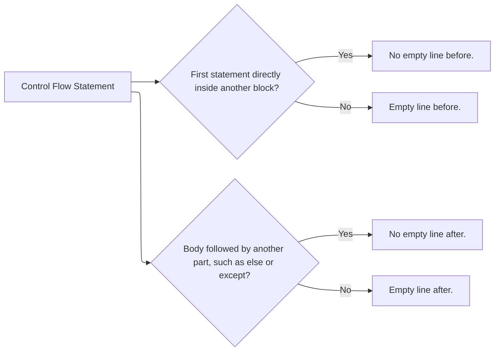

# Code Style & Tooling Guidelines

This document outlines the general style guidelines and the shared tooling and editor configuration for our development, and links to the language-specific style guidelines.

## General Style Guidelines

These guidelines apply to all languages. The language-specific style guidelines are linked in the table under [Editor & Repository Setup](#editor--repository-setup).

### Comments and Logs

- Write comments, log messages, etc. either as full sentences with punctuation, or as Title Case headings without punctuation, such as a comment that labels the code that follows.
- Where a tool has a well-established convention that clashes with ours, follow the tool's convention instead. For example, `argparse` help texts are lowercase without punctuation.

#### Example

```python
parser.add_argument("--output-directory", help="directory to write the package to")

# Validate Inputs
if not pins:
    # Nothing is pinned, so there is no package to build.
    print("Error: No tools are pinned in requirements-dev.txt.", file=sys.stderr)
    sys.exit(1)
```

### Empty Lines Around Control Flow



#### Example

```python
total = 0

for row in rows:
    for cell in row:
        if cell is None:
            continue

        total += cell

if total > limit:
    print("The total exceeds the limit.")
else:
    print("The total is within the limit.")

print(f"Total: {total}")
```

## Tooling & Editor Configuration

We use **[Visual Studio Code](https://code.visualstudio.com/)** as our primary IDE. To ensure everyone's code is formatted identically and automatically upon saving, you must set up the tools and editor as described below.

### Tools

[![Version][version-badge]][control] [![Build][build-badge]][build] [![Ubuntu][ubuntu-badge]][apt-repo] [![Architectures][architectures-badge]][workflow]

[![actionlint-py][actionlint-py-badge]][tools] [![clang-format][clang-format-badge]][tools] [![dprint-py][dprint-py-badge]][tools] [![ruff][ruff-badge]][tools] [![rumdl][rumdl-badge]][tools] [![shellcheck-py][shellcheck-py-badge]][tools] [![shfmt-py][shfmt-py-badge]][tools] [![ty][ty-badge]][tools]

[version-badge]: https://img.shields.io/badge/dynamic/yaml?url=https%3A%2F%2Fraw.githubusercontent.com%2Fsfg-autonomous-systems%2F.github%2Fmain%2Fsrc%2Fsfg-contribution-tooling%2FDEBIAN%2Fcontrol&query=%24.Version&label=sfg-contribution-tooling&color=A81D33&logo=debian&logoColor=white
[build-badge]: https://img.shields.io/github/actions/workflow/status/sfg-autonomous-systems/.github/build_and_submit_packages.yaml?branch=main&label=build&logo=githubactions&logoColor=white
[ubuntu-badge]: https://img.shields.io/badge/dynamic/yaml?url=https%3A%2F%2Fraw.githubusercontent.com%2Fsfg-autonomous-systems%2F.github%2Fmain%2F.github%2Fworkflows%2Fbuild_and_submit_packages.yaml&query=%24.jobs.submit.strategy.matrix.distribution%5B*%5D&label=Ubuntu&color=E95420&logo=ubuntu&logoColor=white
[architectures-badge]: https://img.shields.io/badge/dynamic/yaml?url=https%3A%2F%2Fraw.githubusercontent.com%2Fsfg-autonomous-systems%2F.github%2Fmain%2F.github%2Fworkflows%2Fbuild_and_submit_packages.yaml&query=%24.jobs.build.strategy.matrix.include%5B*%5D.architecture&label=architectures&color=blue
[actionlint-py-badge]: https://img.shields.io/badge/dynamic/toml?url=https%3A%2F%2Fraw.githubusercontent.com%2Fsfg-autonomous-systems%2F.github%2Fmain%2Fsrc%2Fsfg-contribution-tooling-tools.toml&query=%24%5B%27actionlint-py%27%5D.version&label=actionlint-py&color=informational
[clang-format-badge]: https://img.shields.io/badge/dynamic/toml?url=https%3A%2F%2Fraw.githubusercontent.com%2Fsfg-autonomous-systems%2F.github%2Fmain%2Fsrc%2Fsfg-contribution-tooling-tools.toml&query=%24%5B%27clang-format%27%5D.version&label=clang-format&color=informational
[dprint-py-badge]: https://img.shields.io/badge/dynamic/toml?url=https%3A%2F%2Fraw.githubusercontent.com%2Fsfg-autonomous-systems%2F.github%2Fmain%2Fsrc%2Fsfg-contribution-tooling-tools.toml&query=%24%5B%27dprint-py%27%5D.version&label=dprint-py&color=informational
[ruff-badge]: https://img.shields.io/badge/dynamic/toml?url=https%3A%2F%2Fraw.githubusercontent.com%2Fsfg-autonomous-systems%2F.github%2Fmain%2Fsrc%2Fsfg-contribution-tooling-tools.toml&query=%24.ruff.version&label=ruff&color=informational
[rumdl-badge]: https://img.shields.io/badge/dynamic/toml?url=https%3A%2F%2Fraw.githubusercontent.com%2Fsfg-autonomous-systems%2F.github%2Fmain%2Fsrc%2Fsfg-contribution-tooling-tools.toml&query=%24.rumdl.version&label=rumdl&color=informational
[shellcheck-py-badge]: https://img.shields.io/badge/dynamic/toml?url=https%3A%2F%2Fraw.githubusercontent.com%2Fsfg-autonomous-systems%2F.github%2Fmain%2Fsrc%2Fsfg-contribution-tooling-tools.toml&query=%24%5B%27shellcheck-py%27%5D.version&label=shellcheck-py&color=informational
[shfmt-py-badge]: https://img.shields.io/badge/dynamic/toml?url=https%3A%2F%2Fraw.githubusercontent.com%2Fsfg-autonomous-systems%2F.github%2Fmain%2Fsrc%2Fsfg-contribution-tooling-tools.toml&query=%24%5B%27shfmt-py%27%5D.version&label=shfmt-py&color=informational
[ty-badge]: https://img.shields.io/badge/dynamic/toml?url=https%3A%2F%2Fraw.githubusercontent.com%2Fsfg-autonomous-systems%2F.github%2Fmain%2Fsrc%2Fsfg-contribution-tooling-tools.toml&query=%24.ty.version&label=ty&color=informational
[control]: ../src/sfg-contribution-tooling/DEBIAN/control
[build]: https://github.com/sfg-autonomous-systems/.github/actions/workflows/build_and_submit_packages.yaml?query=branch%3Amain
[apt-repo]: https://github.com/sfg-autonomous-systems/sfg_apt_repo
[workflow]: ../.github/workflows/build_and_submit_packages.yaml
[tools]: ../src/sfg-contribution-tooling-tools.toml

All formatters and linters come in the `sfg-contribution-tooling` package. [Add the SFG APT repository](https://github.com/sfg-autonomous-systems/sfg_apt_repo#add-the-apt-repository), then install the package:

```bash
sudo apt install sfg-contribution-tooling
```

### Editor & Repository Setup

In the repository root, run:

```bash
sfg-contribution-tooling init
```

See `sfg-contribution-tooling init --help` for what it does and its options.

| Language                  | Tools                      | Extensions                                                                       | Configuration Files                                                              | Language-Specific Style Guidelines |
| ------------------------- | -------------------------- | -------------------------------------------------------------------------------- | -------------------------------------------------------------------------------- | ---------------------------------- |
| C/C++                     | `clang-format`             | [`ms-vscode.cpptools`][cpptools]                                                 | [`.clang-format`](config/.clang-format)                                          | [C/C++](style/c_cpp.md)            |
| CMake                     |                            | [`josetr.cmake-language-support-vscode`][cmake]                                  |                                                                                  | [CMake](style/cmake.md)            |
| Dockerfile/JSON/TOML/YAML | `dprint`                   | [`dprint.dprint`][dprint]                                                        | [`dprint.jsonc`](config/dprint.jsonc)                                            |                                    |
| GitHub Actions            | `actionlint`, `shellcheck` | [`jimeh.actionlint`][actionlint]                                                 |                                                                                  |                                    |
| Markdown                  | `rumdl`                    | [`rvben.rumdl`][rumdl]                                                           | [`.rumdl.toml`](config/.rumdl.toml)                                              |                                    |
| Python                    | `ruff`, `ty`               | [`ms-python.python`][python], [`charliermarsh.ruff`][ruff], [`astral-sh.ty`][ty] | [`ruff.toml`](config/ruff.toml), [`ty.toml`](config/ty.toml)                     | [Python](style/python.md)          |
| Shell                     | `shellcheck`, `shfmt`      | [`mads-hartmann.bash-ide-vscode`][bash-ide]                                      | [`.editorconfig`](config/.editorconfig), [`.shellcheckrc`](config/.shellcheckrc) | [Shell](style/shell.md)            |

[cpptools]: https://marketplace.visualstudio.com/items?itemName=ms-vscode.cpptools
[cmake]: https://marketplace.visualstudio.com/items?itemName=josetr.cmake-language-support-vscode
[dprint]: https://marketplace.visualstudio.com/items?itemName=dprint.dprint
[actionlint]: https://marketplace.visualstudio.com/items?itemName=jimeh.actionlint
[rumdl]: https://marketplace.visualstudio.com/items?itemName=rvben.rumdl
[python]: https://marketplace.visualstudio.com/items?itemName=ms-python.python
[ruff]: https://marketplace.visualstudio.com/items?itemName=charliermarsh.ruff
[ty]: https://marketplace.visualstudio.com/items?itemName=astral-sh.ty
[bash-ide]: https://marketplace.visualstudio.com/items?itemName=mads-hartmann.bash-ide-vscode

The settings and extensions of each language are in [`languages.jsonc`](../src/sfg-contribution-tooling/opt/sfg-contribution-tooling/share/languages.jsonc), for reference only.

> [!warning]
> ty and Bash IDE look for `ty.toml` and `.shellcheckrc` only in the VS Code workspace directory and its parent directories. Open the repository root as the workspace.

> [!warning]
> Configure each tool in exactly one place. Do not additionally add `[tool.ruff]`, `[tool.rumdl]` or `[tool.ty]` sections to a `pyproject.toml`: `ruff.toml`, `.rumdl.toml` and `ty.toml` take precedence and such sections are ignored.
